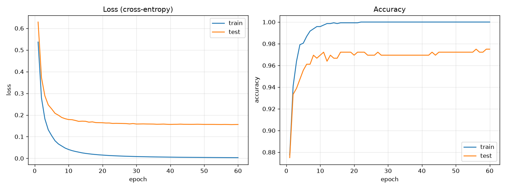

# ДЗ 1. Полносвязная нейронная сеть

Задание:
- полносвязная нейронная сеть;
- функция активации — ReLU;
- softmax на выходе;
- loss считается по кросс-энтропии;
- вывести графики loss и accuracy.

Сеть написана на numpy (прямой и обратный проход вручную). Датасет — рукописные цифры `load_digits` из sklearn (1797 картинок 8x8, 10 классов), 80% на обучение, 20% на тест.

Архитектура: `64 -> 128 (ReLU) -> 64 (ReLU) -> 10 (softmax)`, мини-батчи по 32, SGD, lr = 0.05, 60 эпох.

## Запуск

```bash
python hw1_mlp/mlp.py
```

## Результат

Точность на тесте ~97.5%.


