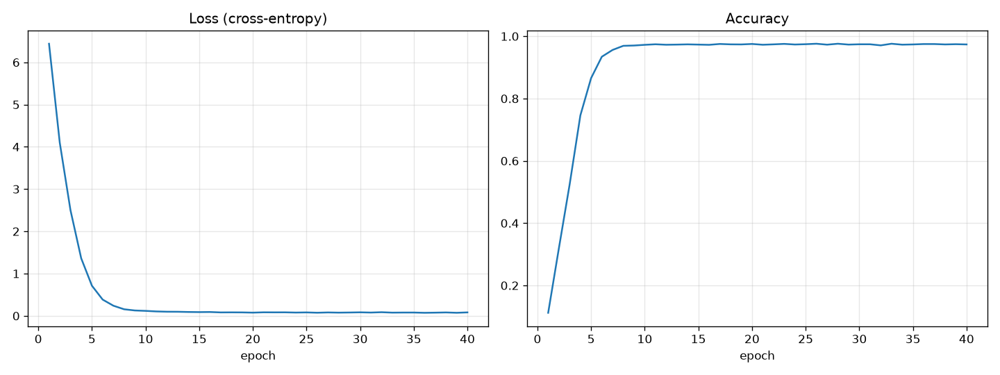

# ДЗ 2. RNN по словам

Задание: написать рекуррентную сеть, которая работает не по символам, а по словам.

Текст — «Сказка о царе Салтане» (`saltan.txt`). Текст переводится в нижний регистр и разбивается на слова регуляркой `[а-яё]+`: 4010 слов, из них 1312 уникальных.

Модель (PyTorch):
- `nn.Embedding` — каждое слово превращается в вектор размера 64;
- рекуррентная ячейка написана вручную: `h = tanh(W · [x_t, h])`, скрытое состояние размера 128;
- выходной слой `hidden -> vocab_size`, loss — `CrossEntropyLoss`;
- на вход подаются 6 слов, сеть предсказывает 7-е;
- Adam, lr = 0.005, батч 64, 40 эпох.

## Запуск

```bash
python hw2_word_rnn/word_rnn.py
```

## Результат

```
три девицы под окном пряли поздно -> вечерком
```

Сгенерированный текст (начало задано, дальше сеть подбирает слова сама):

```
ветер по морю гуляет и кораблик подгоняет он бежит себе в волнах на поднятых
парусах мимо острова крутого мимо города большого пушки с пристани палят ...
```

Текст маленький, поэтому сеть по сути выучивает сказку наизусть. Accuracy останавливается около 97%: некоторые сочетания из 6 слов повторяются в тексте, а продолжения у них разные.


